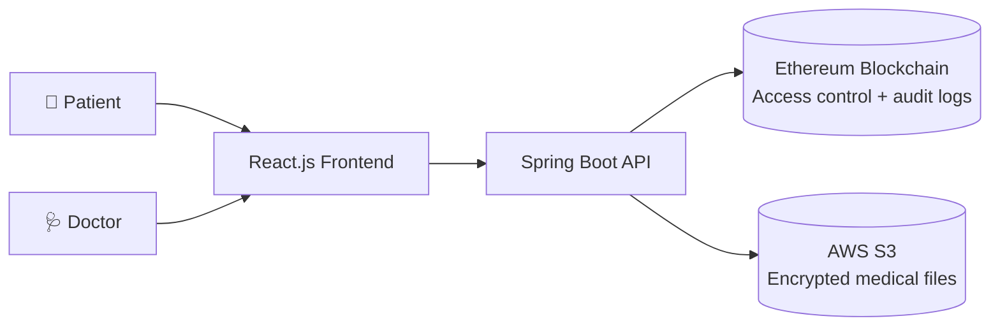

# Hi, I'm Aditya Vijapure 👋

**Full-stack developer building secure, decentralized and data-driven applications**

Java · Spring Boot · React · Blockchain · AWS

---

## 👨‍💻 About Me

I enjoy turning real-world problems into working software, from enterprise-style Java backends to blockchain-powered web apps. I care about clean architecture, security and building things people can actually use.

- 🔭 Building at the intersection of **blockchain, healthcare and cloud**
- 🧱 Comfortable across the stack: **Spring Boot APIs → React frontends → AWS storage**
- 🔐 Interested in **data privacy, access control and tamper-proof audit trails**
- 🤝 Open to collaborating on full-stack and blockchain projects

---

## ⭐ Featured Project

### 🏥 [Decentralized Healthcare Network using Blockchain](https://github.com/adityavijapure/Decentralized-Healthcare-Network-using-Blockchain)

A secure platform where **patients stay in control of their own medical records**. Doctors request access, patients approve or revoke it, and every action is permanently logged on the blockchain. Large files like scans and reports live in encrypted cloud storage.

**Key features**

| | |
|---|---|
| 🔑 **Patient-controlled access** | Patients decide who can view their records and can revoke access at any time |
| 🩺 **Doctor data requests** | Doctors raise access requests that patients approve or reject |
| ⛓️ **Immutable audit trail** | Every access, request and permission change is logged on the Ethereum blockchain |
| ☁️ **Encrypted file storage** | Large medical files are stored encrypted on AWS S3 instead of on-chain |
| 🌐 **Modern web interface** | React.js frontend backed by a Spring Boot REST API |

**How it works**

---

## 🛠️ Tech Stack

**Languages**

**Backend & Frameworks**

**Blockchain & Cloud**

**Tools**

---

## 📂 More Projects

| Project | Description | Tech |
|---|---|---|
| [⛓️ CharityDonation-using-Blockchain](https://github.com/adityavijapure/CharityDonation-using-Blockchain) | Blockchain web app to track and manage charity donations transparently |  |
| [🎓 TPO-sveri-Student-management](https://github.com/adityavijapure/TPO-sveri-Student-management) | Maintains student data for a college training and placement office |  |
| [🚌 Bus-Ticket-Booking-System](https://github.com/adityavijapure/Bus-Ticket-Booking-System) | Advanced Java application with a custom frontend and XAMPP-backed database |  |
| [🏧 ATM-MANAGEMENT-SYSTEM](https://github.com/adityavijapure/ATM-MANAGEMENT-SYSTEM) | Java-based ATM management system |  |
| [💬 DevConnect-platform](https://github.com/adityavijapure/DevConnect-platform) | Platform for connecting developers |  |

---

## 📊 GitHub Stats

---

## 📫 Let's Connect

I'm always happy to talk about full-stack development, blockchain and new project ideas.

⭐ *If you like any of my projects, a star on the repo goes a long way!* ⭐

